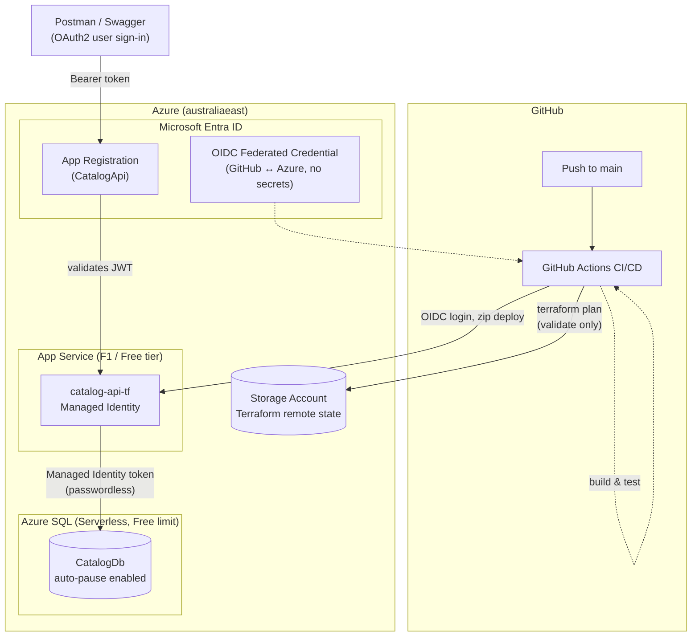

# CatalogApi - Production-Ready .NET 8 Microservice

A clean, production-style RESTful API for managing product catalogs, built with .NET 8 minimal APIs, EF Core 8, and designed for cloud deployment on Azure.

## Overview

CatalogApi is a minimal API microservice that demonstrates industry best practices for cloud-native applications:
- **Clean Architecture**: Separation of concerns with repositories, DTOs, and validators
- **EF Core 8**: Configurable database provider (SQLite for dev, SQL Server for production)
- **Structured Logging**: Built-in logging with optional Application Insights support
- **Health Checks**: Liveness and readiness probes for Kubernetes/container orchestration
- **Cloud-Ready**: Environment-based configuration, non-root Docker container, graceful error handling
- **API Standards**: RFC 7807 ProblemDetails for errors, proper HTTP status codes, pagination support
- **Request Validation**: FluentValidation for input validation with clear error messages

## Project Structure

```
azure-catalog-service/
├── src/
│   └── CatalogApi/
│       ├── Models/                    # Entity models
│       ├── DTOs/                      # Request/response DTOs
│       ├── Data/
│       │   ├── Repositories/          # Repository pattern implementation
│       │   ├── Migrations/            # EF Core migrations
│       │   └── ProductsDbContext.cs   # DbContext
│       ├── Endpoints/                 # Minimal API endpoint mappings
│       ├── Validators/                # FluentValidation validators
│       ├── Middleware/                # Custom middleware (exception handling, logging)
│       ├── Program.cs                 # Application startup configuration
│       └── appsettings*.json          # Configuration files
├── tests/
│   └── CatalogApi.Tests/
│       ├── CatalogApiWebApplicationFactory.cs  # Test fixture
│       └── UnitTest1.cs               # Integration tests
├── Dockerfile                         # Multi-stage Docker build
├── .dockerignore                      # Docker build excludes
├── README.md                          # This file
└── azure-catalog-service.sln          # Solution file
```

## API Specification

### Resources

**Product**
```json
{
  "id": 1,
  "name": "string (required, max 100 chars)",
  "description": "string (optional, max 500 chars)",
  "price": 99.99,
  "createdAtUtc": "2026-10-01T09:10:23.051104Z"
}
```

### Endpoints

| Method | Route | Description |
|--------|-------|-------------|
| GET | `/api/products?page=1&pageSize=20` | List products (paginated) |
| GET | `/api/products/{id}` | Get product by ID |
| POST | `/api/products` | Create product (returns 201 with Location header) |
| PUT | `/api/products/{id}` | Update product |
| DELETE | `/api/products/{id}` | Delete product (returns 204) |
| GET | `/health` | Liveness probe (no DB check) |
| GET | `/health/ready` | Readiness probe (checks DB connectivity) |

### Status Codes

- **200 OK**: GET, PUT successful
- **201 Created**: POST successful (with Location header and response body)
- **204 No Content**: DELETE successful
- **400 Bad Request**: Validation failed (ProblemDetails response)
- **404 Not Found**: Resource not found (ProblemDetails response)
- **500 Internal Server Error**: Unhandled exception (ProblemDetails response)

### Error Responses

All errors return [RFC 7807 ProblemDetails](https://tools.ietf.org/html/rfc7807):
```json
{
  "title": "Validation Failed",
  "detail": "Product name is required; Price must be greater than 0",
  "status": 400
}
```

## Getting Started

### Prerequisites

- .NET 8 SDK or later
- (Optional) SQL Server for production use

### Local Development

1. **Clone and restore**
   ```bash
   git clone <repo-url>
   cd azure-catalog-service
   dotnet restore
   ```

2. **Run the API**
   ```bash
   dotnet run --project src/CatalogApi
   ```
   
   The API will start on `http://localhost:8080` and seed 3 sample products in Development.

3. **View Swagger documentation**
   - Open http://localhost:8080/swagger in your browser (Development environment only)

4. **Test endpoints**
   ```bash
   # Health check
   curl http://localhost:8080/health
   
   # Get all products
   curl http://localhost:8080/api/products
   
   # Create a product
   curl -X POST http://localhost:8080/api/products \
     -H "Content-Type: application/json" \
     -d '{"name":"Laptop","description":"High-performance laptop","price":1299.99}'
   ```

## Running Tests

```bash
# Run all tests
dotnet test

# Run with verbose output
dotnet test -v normal

# Run specific test class
dotnet test --filter "NamespaceName.ClassName"
```

Integration tests use an in-memory SQLite database and cover:
- Product CRUD operations
- Validation error handling (400 Bad Request)
- Not found scenarios (404)
- Pagination
- Health endpoints

## Configuration

All settings come from environment variables (no secrets in code). Supports multiple appsettings files per environment.

### Configuration Table

| Setting | Environment Variable | Default | Purpose |
|---------|----------------------|---------|---------|
| Database Provider | `Database__Provider` | `Sqlite` | `Sqlite` (dev) or `SqlServer` (prod) |
| Connection String | `ConnectionStrings__CatalogDb` | `Data Source=catalog.db` | SQLite file path or SQL Server connection string |
| Apply Migrations | `Database__ApplyMigrationsOnStartup` | `true` (dev), `false` (prod) | Auto-apply migrations at startup |
| Application Insights | `APPLICATIONINSIGHTS_CONNECTION_STRING` | (not set) | Optional; enables telemetry if configured |
| Port | `PORT` | `8080` | HTTP listening port |
| Environment | `ASPNETCORE_ENVIRONMENT` | `Production` | `Development` or `Production` |

### Example: Using SQL Server

```bash
# Linux/macOS
export Database__Provider=SqlServer
export ConnectionStrings__CatalogDb="Server=localhost;Database=CatalogDb;Trusted_Connection=true;"
export Database__ApplyMigrationsOnStartup=false
dotnet run --project src/CatalogApi

# Windows
set Database__Provider=SqlServer
set ConnectionStrings__CatalogDb=Server=localhost;Database=CatalogDb;Trusted_Connection=true;
set Database__ApplyMigrationsOnStartup=false
dotnet run --project src/CatalogApi
```

### Example: Enabling Application Insights

```bash
export APPLICATIONINSIGHTS_CONNECTION_STRING="InstrumentationKey=..."
dotnet run --project src/CatalogApi
```

## Docker

### Build

```bash
docker build -t catalog-api:latest .
```

### Run

```bash
# Using SQLite (default)
docker run -p 8080:8080 \
  -e Database__Provider=Sqlite \
  -e ConnectionStrings__CatalogDb="Data Source=/data/catalog.db" \
  -v $(pwd)/data:/data \
  catalog-api:latest

# Using SQL Server
docker run -p 8080:8080 \
  -e Database__Provider=SqlServer \
  -e ConnectionStrings__CatalogDb="Server=sql-server;Database=CatalogDb;User=sa;Password=YourPassword;" \
  -e Database__ApplyMigrationsOnStartup=false \
  catalog-api:latest
```

**Notes:**
- Container runs as non-root user (appuser:1001) for security
- Listens on port 8080
- Multi-stage build keeps final image small (~300MB)

## Cloud Architecture & Deployment

CatalogApi runs on Azure, fully provisioned via **Terraform** and deployed via **GitHub Actions** — no manual portal clicks, no stored cloud secrets, and no passwords in configuration.



### How it's deployed

1. **Infrastructure as code** — every Azure resource (resource group, SQL server/database, App Service plan, web app, firewall rules) is declared in Terraform under `terraform/`. State is stored remotely in an Azure Storage account, authenticated via Azure AD (no storage account keys). `terraform plan` shows zero drift at all times — the live environment matches the code exactly.

2. **CI/CD pipeline** (`.github/workflows/ci.yml`) runs on every push to `main`:
   - **Build & test** — restores, builds, and runs the full xUnit test suite.
   - **Terraform validate & plan** — checks formatting, validates syntax, and runs a dry-run plan against the real Azure environment.
   - **Deploy** — publishes the API and zip-deploys it straight to the App Service.

3. **No stored cloud credentials** — GitHub authenticates to Azure using **OpenID Connect (OIDC) federation**: a short-lived token is issued per workflow run and exchanged for Azure access, scoped with least-privilege roles (read-only for planning, deploy-only on the specific web app). There is no Azure client secret sitting in GitHub at all.

4. **Passwordless database access** — the Web App authenticates to Azure SQL using its own **system-assigned managed identity**, not a username/password. The identity is granted access inside the database as a contained user (`CREATE USER ... FROM EXTERNAL PROVIDER`), scoped to `db_datareader`/`db_datawriter` only.

5. **User authentication** — API callers (Postman, Swagger, or a real client) sign in via **Microsoft Entra ID** (supporting both work/school and personal Microsoft accounts) and present a JWT bearer token, which the API validates against its Entra app registration before allowing access to `/api/products`. Health check endpoints (`/health`, `/health/ready`) stay unauthenticated for monitoring.

6. **Cost control** — the SQL database uses Azure's **free-limit** offer with auto-pause, and the App Service runs on the **F1 (Free)** tier — the entire environment runs at effectively zero cost.

## Development

### Adding a New Endpoint

1. Create a DTO in `DTOs/`
2. Create a validator in `Validators/` (if needed)
3. Add the endpoint function to `Endpoints/ProductEndpoints.cs`
4. Register in `Program.cs` via `app.MapProductEndpoints()`

### Database Migrations

```bash
# Create a new migration
dotnet ef migrations add MigrationName --project src/CatalogApi

# Apply migrations (also runs on startup if configured)
dotnet ef database update --project src/CatalogApi

# View migration status
dotnet ef migrations list --project src/CatalogApi
```

### Code Style

- Follow C# naming conventions (PascalCase for public types, camelCase for locals)
- Minimal inline comments; prefer clear naming
- DTOs for all request/response payloads (never expose entities)
- Use repository pattern for data access abstraction
- Validation via FluentValidation, not data annotations

## Roadmap

Future enhancements for production deployment:

- [ ] **Azure App Service**: Publish to App Service for traditional hosting
- [ ] **Azure SQL Database**: Switch to managed SQL Server
- [ ] **Azure Key Vault**: Secure credential management with managed identity
- [ ] **Azure Container Apps**: Serverless containerized deployment
- [ ] **Entra ID OIDC**: OpenID Connect authentication with Microsoft Entra ID
- [ ] **GitHub Actions CI/CD**: Automated testing and deployment pipeline
- [ ] **Terraform**: Infrastructure as Code for Azure resources
- [ ] **OpenTelemetry**: Distributed tracing and observability
- [ ] **Azure Service Bus**: Async messaging integration
- [ ] **API Versioning**: Support multiple API versions

## Production Checklist

Before deploying to production:

- [ ] Run all tests: `dotnet test`
- [ ] Run Docker build: `docker build -t catalog-api:latest .`
- [ ] Test Docker container with SQL Server connection
- [ ] Configure Application Insights in Azure Portal
- [ ] Set up Key Vault for connection strings and secrets
- [ ] Enable managed identity for authentication
- [ ] Configure network security groups and firewall rules
- [ ] Enable Azure SQL firewall for App Service
- [ ] Set up CI/CD pipeline in GitHub Actions
- [ ] Configure logging and monitoring alerts
- [ ] Load test with representative data volume
- [ ] Test failover and disaster recovery scenarios

## Troubleshooting

### "Unable to find the required services"
Ensure all middleware dependencies are registered in `Program.cs`. Check the order of `builder.Services.Add*()` calls.

### Database connection errors in tests
Ensure `CatalogApiWebApplicationFactory` correctly configures the in-memory SQLite connection and keeps it open during test execution.

### Migrations not applying
Check `Database__ApplyMigrationsOnStartup` is `true` and the application has permission to write to the database directory/server.

## License

This project is provided as-is for learning and demonstration purposes.

## Support

For questions or issues:
1. Check the logs: `docker logs <container-id>`
2. Verify configuration via environment variables
3. Review Application Insights (if enabled) for telemetry
4. Check `/health/ready` endpoint to diagnose startup issues
